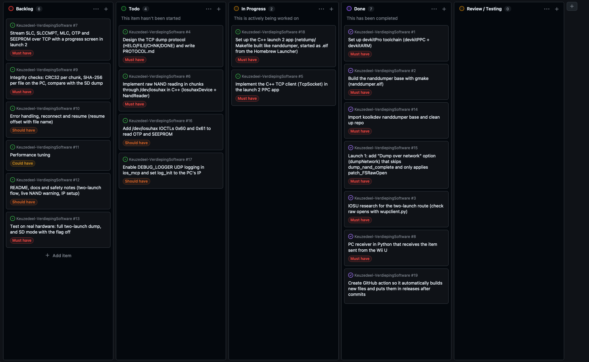

# Logboek Keuzedeel


### 12-09
Vandaag ben ik begonnen met de repo in te stellen en gitIgnore aan te passen. Daarna was ik het scrumbord aan het maken zodat ik hier mijn taken overzichtelijk bij kan houden. Hierna check ik mijn development omgeving om te kijken of er niks mist.

#### Ik zal mijn taken in het Engels bijhouden, dit doe ik omdat het voor mij makkelijker is om gelijk in het Engels een taak te hebben. De rest van documentatie etc. zal wel in het Nederlands zijn.

Ik had een fout gemaakt met wut eerst in deze repo te zetten, dit hoefde helemaal niet. Dus hierna heb ik die eruit gehaald en de NandDumper repo hierin gecloned, Daarna heb ik make geprobeerd om te runnen, dit faalde aangezien Macbooks een hele oude versie standaard al hebben, hiervoor heb ik gmake geinstalleerd en gerunned. Dit werkte en er kwam uiteindelijk een .elf payload uit die gebruikt kon worden. Hiermee is de setup compleet en kan ik focussen op de netwerk logica en mijzelf verdiepen in hoe dingen hier werken. Hierna ben ik bezig gegaan met het onderzoeken van hoe ik dit het beste kan doen, hieruit is gekomen dat het beter is om NandDumper de kernel te laten patchen maar in plaats van direct dumpen, gewoon booten naar de main menu met die patches actief. Zodat ik een andere app kan maken die het over het netwerk kan streamen. Ben eerst aan de slag gegaan met opties toevoegen aan de UI en proberen of ik de console naar de main menu kan booten via deze manier.

Uiteindelijk liep ik tegen een probleem aan. Met de netwerk optie aan, de console zou door moeten booten naar de main menu met de patches. Alleen kreeg ik een error code dat EnvironmentLoader niet 2 keer mag runnen. Dit is een error vanuit Aroma, ik kan dit vermeiden door aroma niet te gebruiken maar het liefst wil ik het wel laten gebruiken. Dus ben ik aan het onderzoeken hoe ik die aanpas. Dit heb ik uiteindelijk opgelost door niet volledig opnieuw de aroma omgeving te laden. Hierna had ik problemen met dat er geen logs doorheen kwam, dit was een fout van mij want ik zat in de verkeerde directory gmake uit te voeren dus kreeg ik niet de laatste payload terug. Ben geeindigd op een zwart scherm na het patchen van de IOS en na de reboot.

Voor logs (luisteren naar port 4405):

```
sudo tcpdump -n -A -i en0 udp port 4405
```


### 13-09
Vandaag ben ik verder gegaan met kijken hoe ik de console normaal laat booten. Hij boot nu naar een zwart scherm waar de console volledig unresponsive is. Ik heb dit opgelost door niet een volledige reboot van het systeem te doen. Hij boot nu in system menu. Ik heb mijn test file waar alle logica van netwerk in gaat zitten etc. een Aroma plugin gemaakt zodat deze code kan executeren na dat het systeem is opgestart met de patches. Hier heb ik een test voor gemaakt zodat ik een file kan krijgen van de Wii U, hier hoort een receiver script bij, dit heb ik in Python gedaan aangezien dit het makkelijkste was. Hiervoor heb ik wel AI gebruikt aangezien ik echt niet wist hoe en wat. Ik heb de AI het niet helemaal laten schrijven alleen een klein begin. Ik krijg nu nog een error als die de SLC nand aan het readen is waardoor de dump incompleet is. Na dit alles ga ik sowieso dingen opruimen en mijzelf hierin verdiepen van hoe alles werkt etc. Ik heb ook nog een GitHub workflow gemaakt waar na elke commit die de 2 files build en gelijk in de releases zet zodat ik niks daar meer hoef te doen en zodat ik het makkelijk terug kan vinden.

Ik ben zelf niet goed in echt rekenen dus daar heb ik AI voor gebruikt. Voor de rest heb ik hem allemaal gevraagd of hij mij alles kon uitleggen zonder code te genereren. Ik heb ook een document gekregen met wat ik hierna moet doen waar gewoon in het algemeen staat beschreven wat mijn plan van aanpak zou zijn. Voor de rest heel veel documentatie gebruikt. En ik ga nu aan de slag met het kijken of ik het kan oplossen van de read errors. Ik denk zelf dat dit komt omdat de Wii U dan vast hangt tussen opstarten en de system menu maar weet ik dit nog niet zeker. Ik zal vanaf nu minder of geen AI gebruiken aangezien ik nog lang de tijd heb. Nu kan ik ten minste mij overal in verdiepen en kijken of ik het aan de praat kan krijgen. Ben nog van plan om een soort progressie scherm te maken aangezien je het nu alleen via de system log kan zien wat die aan het doen is maar dit is natuurlijk niet de bedoeling voor normale mensen die dit zouden willen gebruiken. Maar dit zijn de polishing features die als could have in mijn scrum bord staan.

Het scrumbord zal nog worden aangepast natuurlijk want ik zie nu dat er ook nog launch 2 app open staat, dit is in principe de Aroma plugin maar zal dit beter verwoorden.
